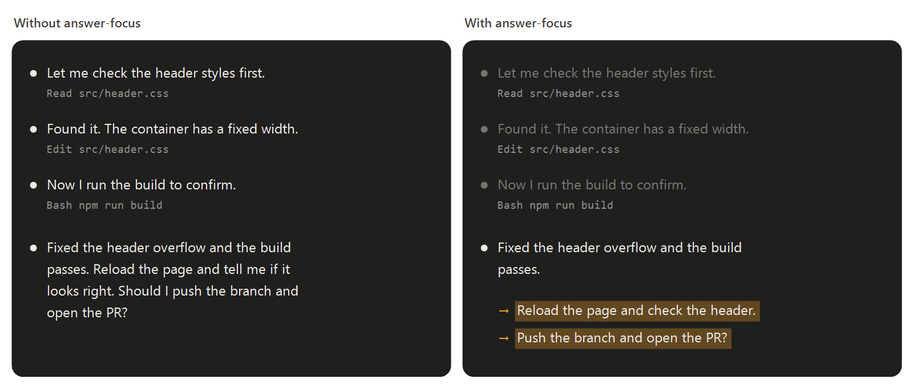

# mod-modicum

Small Claude Code mods, a modicum at a time.



| Mod | What it does |
| --- | --- |
| [answer-focus](plugins/answer-focus) | Dims the text Claude writes between tool calls and highlights what the answer asks you to do. |

## Install

Paste this into Claude Code and it does the rest:

```text
Install this Claude Code plugin from the mod-modicum marketplace (github.com/gilemor/mod-modicum). It needs Claude Code 2.1.282 or newer, so first run claude --version and, if it is older, run claude update. Then run:

claude plugin marketplace add gilemor/mod-modicum
claude plugin install answer-focus@mod-modicum

Then tell me to restart Claude Code so it loads, and to get new versions on their own by turning on auto-update: /plugin → Marketplaces → mod-modicum → Enable auto-update.
```

Or run those two commands yourself and restart Claude Code. Claude can't turn on auto-update for you: it's that one menu step.

**Requires Claude Code 2.1.282 or newer.** Older versions fail with `userConfig.highlightColor: Unrecognized key: "options"` or can't load the mod's code. Run `claude update` and install again.

## License

[MIT](LICENSE)
