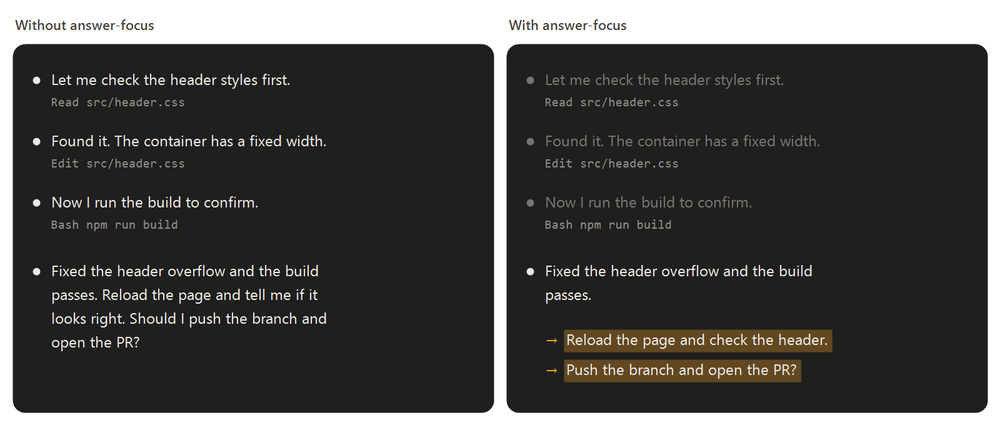

# answer-focus

Hace que la respuesta de Claude resalte sobre el resto del turno.



- **Pasos intermedios atenuados.** Lo que Claude escribe antes de usar herramientas ("Miro el código…", "Ahora los estilos…") se ve atenuado, así la respuesta final destaca al hacer scroll.
- **Lo que te toca, resaltado.** Cuando una respuesta te pide hacer o decidir algo, Claude lo apunta en un bloque `<te-toca>` al final, una acción por línea y escrita para entenderse sola. La mod oculta el bloque y muestra cada línea bajo la respuesta, con una flecha y resaltada. Claude recibe la instrucción una vez por sesión (y otra tras compactar), así que cuesta pocos tokens.

Atenuar los pasos solo cambia cómo se dibujan. El bloque `<te-toca>` sí queda en la conversación, aunque no lo veas. En sesiones reanudadas, los turnos de antes de cargar la mod se ven como siempre.

## Instalación

Pega esto en Claude Code y hará el resto:

```text
Install this Claude Code plugin from the mod-modicum marketplace (github.com/gilemor/mod-modicum). It needs Claude Code 2.1.282 or newer, so first run claude --version and, if it is older, run claude update. Then run:

claude plugin marketplace add gilemor/mod-modicum
claude plugin install answer-focus@mod-modicum

Then tell me to restart Claude Code so it loads, and to get new versions on their own by turning on auto-update: /plugin → Marketplaces → mod-modicum → Enable auto-update.
```

O ejecuta tú esos dos comandos y reinicia Claude Code. El auto-update lo activas tú en ese menú: Claude no puede hacerlo por ti.

**Requiere Claude Code 2.1.282 o superior.** En versiones anteriores falla con `userConfig.highlightColor: Unrecognized key: "options"` o no carga el código del mod. Ejecuta `claude update` e instala de nuevo.

## Opciones

Se cambian desde el menú de configuración de plugins o desde la terminal:

```bash
echo '{"highlightColor": "verde"}' | claude plugin configure answer-focus@mod-modicum --values-stdin
```

| Opción | Qué controla |
| --- | --- |
| Atenuar pasos intermedios (`dimSteps`) | El texto entre herramientas atenuado. |
| Lo que te toca (`actionCard`) | Las acciones resaltadas bajo cada respuesta. |
| Color del resaltado (`highlightColor`) | `ámbar` (por defecto), `amarillo`, `verde`, `azul`, `violeta` o `rosa`. |
